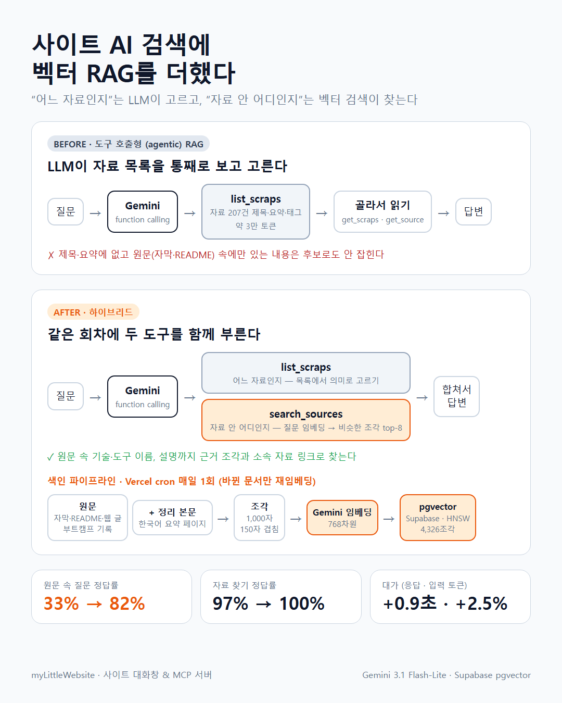
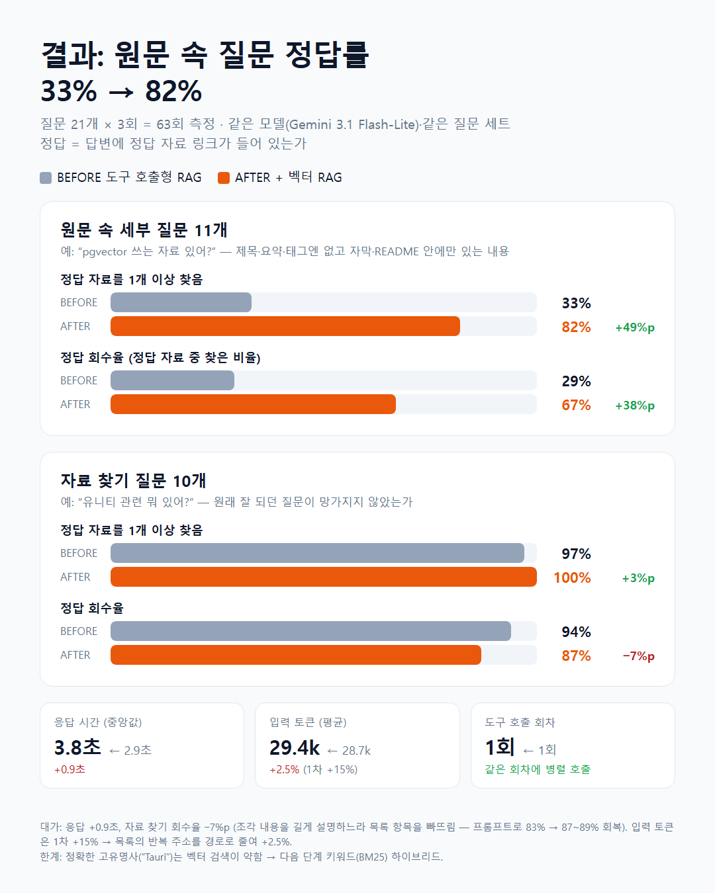
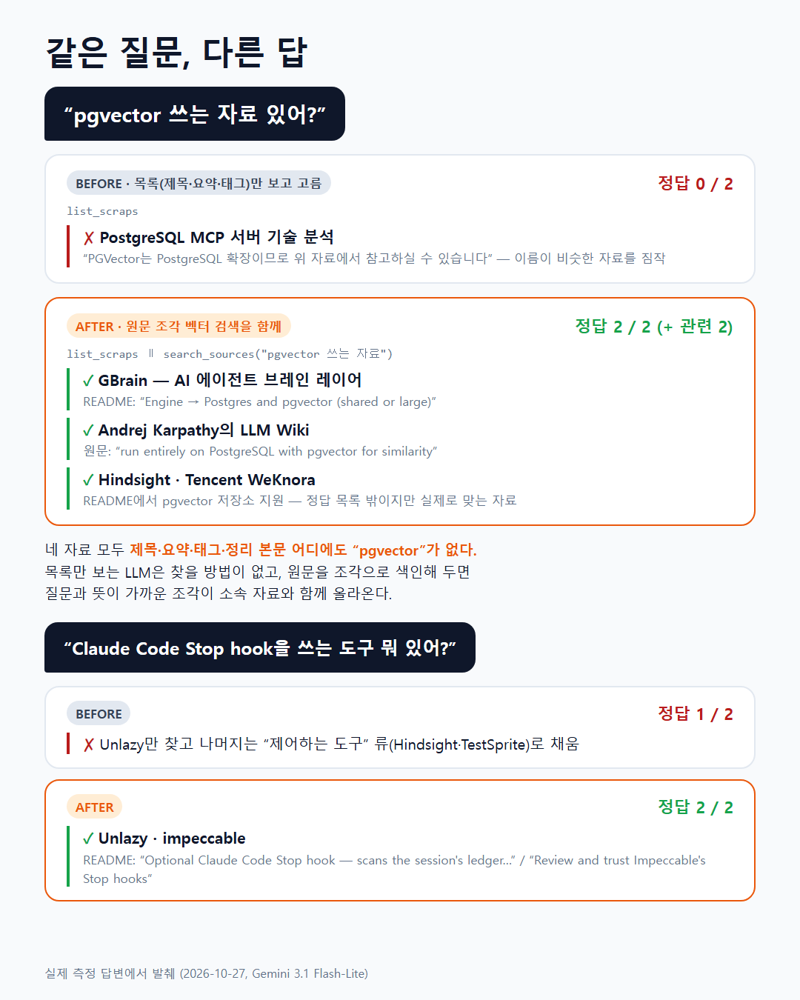

# 도구 호출형 RAG에 벡터 RAG를 더했을 때 — 측정 비교

날짜: 2026-10-27  
태그: [ai, 백엔드, 데이터베이스, 아키텍처]

## 요약

- 사이트 대화창·MCP의 검색은 **도구 호출형(agentic) RAG**였다. LLM이 자료 207건의 제목·요약·태그 목록(약 3만 토큰)을 통째로 보고 고른다. "어느 자료인지"는 잘 고르지만 **제목·요약엔 없고 원문(자막·README) 속에만 있는 내용**은 후보로도 안 잡힌다.
- 원문과 정리 본문을 1,000자 조각으로 나눠 Gemini 임베딩(768차원) + Supabase pgvector로 색인하고, 검색 도구 `search_sources`를 **기존 목록 도구와 같은 회차에 병렬로** 부르게 했다([ADR 0033](../decisions/0033-source-chunk-rag.md)).
- 같은 질문 21개 × 3회 측정: **원문 속 질문에서 정답 자료를 1개 이상 찾는 비율 33% → 82%**, 정답 회수율 29% → 67%. 자료 찾기 질문은 97% → 100%(회수율 94% → 87%). 대가는 응답 +0.9초(중앙값 2.9 → 3.8초), 입력 토큰 +2.5%.
- 토큰: 처음엔 조각 8개(약 9천 자) 때문에 입력 토큰 +15%였다. 기존 목록에서 항목마다 반복되던 사이트 전체 주소(목록의 25%, 1.5만 자)를 경로로 줄여 상쇄 — 정확도 변화 없이 +2.5%.
- 처음 붙였을 땐 자료 찾기 회수율이 94% → 83%로 **떨어졌다** — 조각 본문이 들어오자 모델이 목록을 넓게 나열하는 대신 한 자료를 깊게 설명했다. 프롬프트("빠짐없이 나열, 조각은 근거 한 줄로")로 89%까지 회복.
- 남은 약점: 정확한 고유명사("Tauri")는 벡터 검색이 뜻이 비슷한 다른 조각(Electron)을 올린다 → 키워드(BM25) 하이브리드가 다음 단계.

## 왜 벡터 RAG를 추가했나 (타당성)

### 기존 방식이 잘하는 것과 못 하는 것

기존 대화창은 Gemini function calling으로 MCP 도구를 부른다([ADR 0030](../decisions/0030-site-chat-dock.md)). 자료 질문이 오면 `list_scraps`로 전체 목록(id·제목·요약·태그)을 받아 **LLM이 의미로 고르고**, 필요하면 `get_scraps`(정리 본문)·`get_source`(원문)로 읽는다. 임베딩도 벡터DB도 없다.

| 질문 유형 | 예 | 기존 방식 |
|---|---|---|
| 자료 찾기 | "유니티 관련 뭐 있어?" | 잘함 — 목록의 제목·요약만으로 고를 수 있음 |
| 원문 속 세부 | "pgvector 쓰는 자료 있어?" | 못 함 — "pgvector"는 그 자료의 README 안에만 있음 |

원문 속 세부를 찾으려면 후보마다 `get_source`로 원문을 통째로 읽어야 한다. 원문 실측(2026-10-27): page 33건 평균 2.7만 자, 자막 97건 평균 9천 자, README 38건 평균 2.2만 자 — 합계 약 260만 자. 후보가 무엇인지 모르는 상태에선 읽을 방법 자체가 없다.

### 왜 "교체"가 아니라 "추가"인가

- **어느 자료인지** — 목록이 207건이면 LLM이 전부 보고 고르는 게 벡터 검색보다 정확하다. 같은 날 이 방식의 오탐(섹션 짐작)을 고쳐 자료 찾기 회수율 94%를 확인했다([error-fixes 0009](../error-fixes/0009-chat-search-misses.md)).
- **자료 안 어디인지** — 수천 개 조각에서 뜻이 가까운 부분을 고르는 건 벡터 검색이 맞다.
- 그래서 둘을 **같은 회차에 병렬 호출**한다. 질문 유형을 모델이 판단해 도구를 고르게 하면 판단이 빗나갈 때 망가진다(섹션 짐작 오탐과 같은 구조) — 항상 둘 다 부르면 판단 단계가 없다. 도구 호출 회차는 1회 그대로다.

### 다른 선택지를 배제한 이유

| 대안 | 배제 이유 |
|---|---|
| 목록 검색까지 벡터로 교체 | 목록은 LLM이 전부 보는 게 더 정확 |
| Postgres full-text(`tsvector`) | 한국어 형태소 기본 미지원, "비용 절감" ↔ "prompt caching" 같은 의미·다국어 매칭 불가 |
| 도구 호출 한도만 늘리기 | 후보 자체가 안 잡히는 문제는 못 풂 |
| 외부 벡터DB | 이미 Supabase 사용 중 — pgvector 확장 하나로 끝 |

## 구현

| 단계 | 내용 |
|---|---|
| 색인 대상 | 원문(`scrap_sources`: 자막·README·웹 글) + 부트캠프 기록 → `origin=source`, 사이트 정리 본문(한국어 `bodyMd`) → `origin=body`. 유용한 링크는 사이트 홈이라 제외 |
| 조각 | 약 1,000자, 150자 겹침, 문단 → 줄 → 문장 경계 우선. README의 HTML·`<` 이스케이프 정리 |
| 임베딩 | `gemini-embedding-001`, 768차원(L2 정규화), 문서는 `RETRIEVAL_DOCUMENT` + 자료 제목을 `title`로, 질문은 `RETRIEVAL_QUERY` |
| 저장·검색 | `source_chunks(origin, ref, chunk_idx, text, embedding vector(768))` + HNSW 코사인 인덱스, RPC `match_source_chunks` → 상위 8조각을 소속 자료 id·제목·siteUrl과 함께 반환 |
| 갱신 | Vercel cron 하루 1회(`/api/cron/sources`): 빠진 원문 수집 → 조각을 다시 계산해 **저장된 조각과 다른 문서만** 재임베딩 → 사라진 자료의 조각 삭제. 유튜브는 Vercel IP에서 자막이 막혀 Gemini 영상 요약(`digest`)으로 대신, 로컬 백필이 진짜 자막으로 교체 |

첫 색인: 371문서 → 4,326조각, 로컬 284초. 바뀐 게 없을 때 재실행 3초.

## 측정 방법

- **스크립트**: `npm run eval-chat -w server -- <label> [반복]` → `docs/plans/rag-eval/<label>.json`, `eval-chat compare a b c`로 표.
- **질문 21개**
  - 자료 찾기 10개 — 같은 날 오탐 점검에 쓴 질문(하네스 엔지니어링, 무료 이미지 소스, 목소리 클론, 랙돌, 2D 스프라이트, 언리얼, 루프 엔지니어링, 랜딩페이지, 유니티, 칼럼 중 MCP).
  - 원문 속 세부 11개 — DB에서 **원문에는 있고 제목·요약·태그엔 없는** 키워드를 찾아 문맥을 확인하고 만들었다(prompt caching, Ralph, Stop hook, pgvector, Tauri, ONNX, Blender, PCG, GPU 인스턴싱, 스팀 위시리스트, A2A). 부분 문자열 오탐(LSP·Redis)과 요약에 이미 있는 것(부트캠프 FFT)은 뺐다. 정답 자료는 모두 측정 전부터 원문이 저장돼 있던 것.
- **판정**: 답변에 정답 자료의 사이트 경로(예: `/column/ai-1`, 뒤에 slug 문자가 이어지면 불일치)나 이름(유용한 링크)이 있으면 회수. 회수율 = 찾은 정답 / 정답 수, 정답 1개 이상 = 하나라도 찾은 비율.
- **조건**: 같은 모델(`gemini-3.1-flash-lite`), 각 질문 3회(LLM 비결정성), 순차 실행. 토큰은 Gemini `usageMetadata` 합(도구 루프 전체), 시간은 `chat()` 왕복.
- **라벨**: `before`(구현 전), `after`(1차), `after-v2`(프롬프트 보정), `after-v3`(목록 토큰 절감, 최종).

## 결과

| 지표 | before | after | after-v2 | after-v3 |
|---|---|---|---|---|
| **원문 속 세부** 정답 1개 이상 | 33% | 82% | 79% | **82%** |
| 원문 속 세부 회수율 | 29% | 67% | 65% | **67%** |
| **자료 찾기** 정답 1개 이상 | 97% | 97% | 100% | **100%** |
| 자료 찾기 회수율 | 94% | 83% | 89% | **87%** |
| 전체 회수율 | 60% | 74% | 77% | **76%** |
| 응답 시간 중앙값 | 2.9초 | 4.1초 | 3.8초 | **3.8초** |
| 입력 토큰 평균 | 28,674 | 32,568 | 33,094 | **29,377** |
| 출력 토큰 평균 | 352 | 515 | 531 | **513** |
| 도구 호출(회차) | 1.0 (1) | 2.0 (1) | 2.0 (1) | **2.0 (1)** |

도구 결과 크기: `list_scraps` 6.0만 자 → 5.0만 자(v3, 사이트 주소를 경로로), `search_sources` 약 9천 자.

### 질문별 회수율

| 종류 | 질문 | before | after | after-v2 | after-v3 |
|---|---|---|---|---|---|
| 찾기 | 하네스 엔지니어링 알려줘 | 78% | 67% | 78% | 67% |
| 찾기 | 무료 이미지 소스 사이트 있어? | 100% | 100% | 100% | 100% |
| 찾기 | 목소리 클론 AI 뭐 있어? | 67% | 67% | 100% | 100% |
| 찾기 | 랙돌 관련 자료 | 100% | 100% | 100% | 100% |
| 찾기 | AI로 2D 스프라이트 만드는 방법 | 100% | 33% | 67% | 67% |
| 찾기 | 언리얼 엔진 자료 보여줘 | 100% | 100% | 100% | 100% |
| 찾기 | 루프 엔지니어링에 대해 알려줘 | 100% | 100% | 100% | 67% |
| 찾기 | 랜딩페이지 만들 때 참고할 사이트 | 100% | 83% | 83% | 100% |
| 찾기 | 유니티 관련 뭐 있어? | 100% | 78% | 67% | 72% |
| 찾기 | 칼럼 중에 MCP 관련 글 | 100% | 100% | 100% | 100% |
| 세부 | 프롬프트 캐싱으로 비용이 얼마나 줄어드는지 | 0% | 0% | 0% | 0% |
| 세부 | Ralph 루프 다루는 자료 | 0% | 33% | 33% | 33% |
| 세부 | Claude Code Stop hook을 쓰는 도구 | 50% | 100% | 100% | 100% |
| 세부 | pgvector 쓰는 자료 | 0% | 100% | 100% | 100% |
| 세부 | Tauri로 데스크톱 앱을 만든 AI 도구 | 0% | 0% | 0% | 0% |
| 세부 | ONNX로 돌릴 수 있는 도구 | 0% | 50% | 33% | 50% |
| 세부 | Blender랑 같이 쓸 수 있는 AI 3D 생성 도구 | 100% | 100% | 100% | 100% |
| 세부 | 언리얼 PCG 언급한 자료 | 67% | 100% | 100% | 100% |
| 세부 | GPU 인스턴싱 설명한 자료 | 100% | 100% | 100% | 100% |
| 세부 | 스팀 위시리스트 얘기한 자료 | 0% | 50% | 50% | 50% |
| 세부 | A2A 프로토콜 언급한 자료 | 0% | 100% | 100% | 100% |

## 해석

### 잘 된 것

- **pgvector·A2A·Stop hook**: 키워드가 README·원문 한 문단에만 있는 질문. 기존 방식은 이름이 비슷한 자료(PostgreSQL MCP 서버)를 짐작했고, 벡터 검색은 해당 문단을 소속 자료와 함께 올렸다. pgvector 질문의 정답 4건(정답 목록 2 + 실제로 맞는 2)은 제목·요약·태그·정리 본문 어디에도 "pgvector"가 없다.
- **이미 되던 세부 질문(Blender·GPU 인스턴싱)**: 질문이 자료 주제와 가까워 목록만으로도 찾혔다 — "원문 속 세부"라도 주제가 맞으면 기존 방식이 이미 처리한다.

### 대가와 1차 회귀

- **응답 +0.9초**: 질문 임베딩(약 0.5초) + 늘어난 입력·출력. 도구 회차가 늘지 않아서 이 정도로 끝났다.
- **입력 토큰 +15% → +2.5%**: 늘어난 건 조각 8개(약 9천 자)였다. 기존 목록을 들여다보니 항목마다 `https://…vercel.app/column/slug` 전체 주소가 207번 반복돼 목록의 25%(1.5만 자)를 차지했다. 도메인은 도구 설명에 한 번만 두고 항목엔 경로(`/column/slug`)만 넣어 1만 자를 줄였고, 대화창은 사이트 안이라 경로 링크로 바로 열린다. 정확도는 그대로(v2 → v3).
- **자료 찾기 회수율 94% → 83% (1차)**: 조각 본문이 들어오자 모델이 "2D 스프라이트 만드는 방법"에 3건 나열 대신 AetherAI 사용법을 5단계로 풀고 2건만 다뤘다. 넓게 → 깊게로 답의 성격이 바뀐 것. 프롬프트에 "관련 자료를 빠짐없이 나열, 조각은 이 자료의 어디에 그 내용이 나오는지 근거 한 줄로만"을 넣어 89%로 회복. 유니티(6건)처럼 정답이 많은 질문은 여전히 일부를 뺀다.

### 남은 실패

- **Tauri 0%**: 벡터 검색은 "Tauri 데스크톱 앱"에 뜻이 비슷한 Electron 문서를 올렸다. 정확한 고유명사는 임베딩보다 **키워드 일치**가 강하다 → BM25(또는 `pg_trgm`)와 섞는 하이브리드 검색이 다음 후보.
- **프롬프트 캐싱 0%**: 벡터 검색은 cache-tax(프롬프트 캐시 전용 도구)·claude-reflect를 올렸고 답변도 그쪽을 냈다. 실제로 관련 있는 자료지만 정답 목록(karpathy 위키)에 없어서 0점 — 측정의 한계(정답 목록이 좁음).
- **Ralph 33%**: 칼럼 하나는 자막에 "레프 이금 루프"(음성 인식 오류)로 적혀 있어 키워드로는 못 찾고 의미로만 걸린다.

### 측정의 한계

- 질문 21개, 반복 3회 — 질문당 1건 차이가 5~10%p로 보인다. 자료 찾기 87~89% vs 94%는 유니티·스프라이트 등 두세 질문의 차이고, v2·v3 사이 질문별 출렁임(루프 엔지니어링 100% → 67%, 랜딩페이지 83% → 100%)도 같은 크기다.
- 정답 목록은 사람이 고른 최소 집합이다. 목록 밖의 맞는 답은 점수에 안 들어간다(과소평가 쪽).
- after 측정 전에 로컬 백필(cron과 같은 작업)로 원문 32건이 추가됐다(측정 대상 정답은 모두 그 전부터 있던 원문). 추가된 원문은 정답 목록 밖 관련 자료(Hindsight·WeKnora)로만 답에 나타났다.

## 참고

- 결정·설계: [ADR 0033](../decisions/0033-source-chunk-rag.md), 계획 [2026-10-27-source-rag.md](../plans/2026-10-27-source-rag.md), SQL [2026-10-27-source-chunks.sql](../plans/2026-10-27-source-chunks.sql)
- 원본 측정: [rag-eval/](../plans/rag-eval/) — `before.json`·`after.json`·`after-v2.json`·`after-v3.json`(질문·답변 전문·토큰·도구 호출), `summary.json`
- 이미지 원본: `rag-eval/img-*.html` (Chrome 헤드리스로 1080×1350 PNG)
- 같은 날 고친 목록 검색 오탐: [error-fixes 0009](../error-fixes/0009-chat-search-misses.md)
